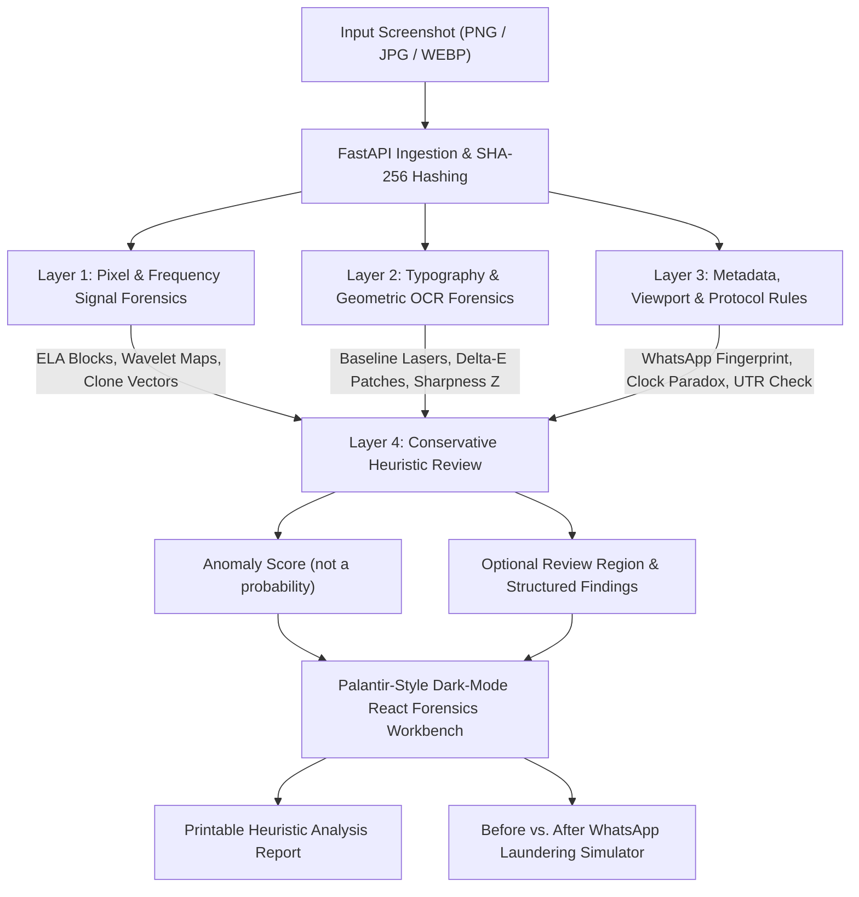

# VeriSight — System Architecture Specification
**HackStellar 2026 — Problem Statement 12: "Is This Screenshot Real?"**

---

## 1. Architectural Philosophy and Limits

The current prototype does not call a vision-language model. It runs OpenCV-based image checks and hand-written metadata rules. There is no learned classifier, OCR text recognition, payment-provider connection, or representative training/evaluation corpus in this build.

**VeriSight** provides an experimental multi-layer forensic review pipeline. Its heuristics can surface anomalies but cannot prove authenticity or verify a payment:
- **Layer 1 (Signal & Frequency):** Measures physical pixel and frequency domain residuals.
- **Layer 2 (Typography & Geometry):** Measures sub-pixel font rasterization, baselines, and local background patches.
- **Layer 3 (Metadata & Domain Rules):** Inspects container chunks, WhatsApp media laundering, mobile viewport geometry, and domain protocol paradoxes.
- **Layer 4 (Evidence Combination):** Uses conservative heuristic scoring and corroboration; scores are not calibrated probabilities.



---

## 2. Component Architecture

### 2.1 Backend (`verisight/backend/`)
The backend is built as a high-performance, asynchronous FastAPI service:
- **`app/main.py`:** Application lifespan, CORS middleware, static sample mount, and REST router mounting.
- **`app/api/endpoints.py`:**
  - `GET /api/health` — Service readiness and dependency health checks.
  - `GET /api/demo-samples` — Lists the 5 pre-generated golden demonstration screenshots with ground-truth scenarios.
  - `POST /api/analyze` — Multipart file upload triggering full 4-layer forensic investigation.
  - `POST /api/analyze-sample` — Instant 1-click execution against any golden demonstration sample.
  - `POST /api/simulate-whatsapp` — Simulates WhatsApp media delivery pipeline (EXIF stripping, resizing to max 1600px, 4:2:0 subsampling, JPEG Q=77) and returns side-by-side comparison telemetry.
  - `POST /api/mobile-upload` — Mobile file upload route accessed by stage judges scanning the QR code.
  - `GET /api/latest-mobile-upload` — Long-poll / fetch endpoint allowing the desktop workbench to pop up phone uploads live.
  - `GET /api/network-info` — Auto-detects the host machine's local LAN IP address (`192.168.x.x`) to construct the mobile QR upload URL.
- **`app/core/schemas.py`:** Strict Pydantic v2 data models for bounding boxes, baseline lasers, layer results, findings, and full analysis reports.
- **`app/services/forensic/`:**
  - `pixel_analysis/`: Multi-scale ELA, Daubechies db4 wavelet noise variance, ORB copy-move translation vector clustering, and JPEG ghost analysis.
  - `typography/`: Dual-engine text extractor (EasyOCR with fast OpenCV Morphological Gradient + Connected-Components fallback), Horizontal baseline laser regression, and CIELAB $\Delta E_{ab}$ perceptual card patch detector.
  - `metadata/`: Container chunk parser (EXIF/PNG/ICC), WhatsApp media fingerprinter, viewport aspect ratio database, status-bar clock temporal paradox validator, and 12-digit UPI UTR validator.
  - `provenance/`: Possible C2PA marker detection only; signature, trust chain, and asset binding are not validated.
  - `adapters/`: Clean optional adapter for learned deep models (TruFor / Noiseprint).
  - `ensemble/`: Conservative heuristic scorer; sufficiently strong copy-move and baseline overlap can localize a review region.
  - `simulation/`: WhatsApp recompression and resizing pipeline simulator.

### 2.2 Frontend (`verisight/frontend/`)
The frontend is a Palantir/Sherloq-inspired dark-mode intelligence workbench built with React, Vite, Tailwind CSS, Lucide Icons, and Framer Motion:
- **Canvas Color Palette:**
  - Background Canvas: `#070b14` (Deep void black)
  - Panels & Cards: `#0f172a` / `#0c1322` (Slate/Navy)
  - Aligned Typography Lasers: `#38bdf8` (Electric Cyan)
  - Review Indicators: `#f43f5e` (Crimson / Rose)
  - Low Anomaly Indicators: `#10b981` (Emerald Green)
- **Interactive Multi-Spectral Canvas (`ForensicViewer.tsx`):**
  - View modes: Original Image, ELA Heatmap, Wavelet Noise Map, Copy-Move Clone Vectors, Split Comparison, and Quad-Grid Matrix.
  - Interactive SVG Overlays: Crisp horizontal baseline laser lines with pixel-drift callout badges (+3.5px DRIFT | ΔE=5.2) and anomaly bounding box reticles.
  - 3x Synchronized Forensic Loupe: Moving the cursor over the image displays a floating dual Picture-in-Picture magnifying glass showing 3x zoomed Original Pixels side-by-side with 3x zoomed ELA/Wavelet pixels at that exact coordinate.
- **Evidence Dossier Sidebar (`RiskDossierSidebar.tsx`):**
  - Animated Radial Tamper Gauge ($0\text{–}100\%$), Confidence %, and Detected Channel Pill (e.g., Native Capture vs. WhatsApp Re-Compressed).
  - 4-Layer Telemetry Progress Bars with expandable mathematical measurement tables.
  - Clickable Findings Feed: Clicking any anomaly highlights and pulses the exact bounding box on the central canvas.
- **Top Command & Demo Bar (`TopCommandBar.tsx`):**
  - 1-Click Golden Sample Pills (Samples 1–5).
  - Simulate WhatsApp Forward Button with before/after comparison modal.
  - Live Judge Mobile Upload QR Button.
  - Export Printable Analysis Report Button.
- **Mobile Upload Route (`MobileUploadView.tsx`):**
  - Triggered automatically via `?mode=mobile`. Clean, high-contrast mobile upload interface for stage judges.

---

## 3. Data Contracts & Bounding Box Specification

Every anomaly detected across all 4 layers conforms to the unified coordinate schema:
```typescript
interface BoundingBox {
  x: number;          // Left offset in original image pixels
  y: number;          // Top offset in original image pixels
  width: number;      // Bounding box width
  height: number;     // Bounding box height
  label: string;      // Human-readable title (e.g. "Spliced Amount Patch")
  confidence: number; // 0.0 to 1.0
  layer: number;      // 1, 2, 3, or 4
  anomaly_type: string; // e.g. "ELA_MACROBLOCK_OUTLIER", "SUBPIXEL_BASELINE_DRIFT"
  details?: Record<string, any>;
}
```

---

## 4. Conservative Evidence Combination

The pipeline uses handcrafted heuristics rather than a trained or calibrated classifier. Low-level pixel variation, JPEG recompression, viewport cropping, and software metadata are weak review cues and can also occur in ordinary images. PNG ELA is shown only as an exploratory view and is excluded from scoring. Results are `INCONCLUSIVE`, `REVIEW_REQUIRED`, or `CORROBORATED_ANOMALIES`; none asserts that an image is genuine or fake. An overlapping region is highlighted only when a sufficiently strong copy-move match intersects a flagged text baseline. The score is a heuristic point scale and classifier confidence is unavailable.

The offline text component extractor does not recognize words. Time and transaction-reference rules that require recognized image text are therefore unavailable in the current build. QR payloads can be decoded locally and displayed for manual review, but decoding does not validate the destination, payee, or payment. File metadata can be inspected, but it does not independently verify transaction content. Possible C2PA marker strings are detected without validating the manifest or its signature.

---

*Architecture approved for implementation.*
